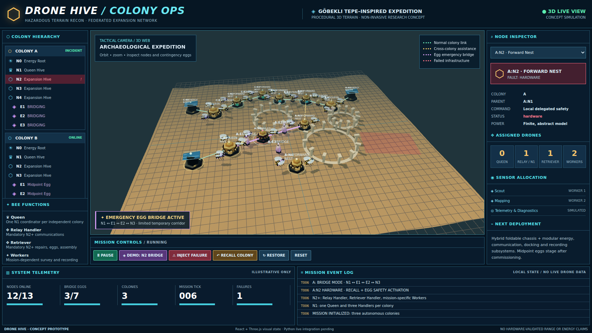

# DRONE HIVE · Federated Colony Reconnaissance

**Bee-inspired multi-colony research software for fault-tolerant, non-invasive exploration of hazardous or inaccessible terrain.** A reproducible Python simulation is complemented by a **scripted** React/Three.js mission console. Archaeological landscapes are **Göbekli Tepe-inspired visualizations, not licensed surveys or actual archaeological measurements**.

**Research status:** Stage One is a frozen 2D historical simulation; Stage Two is an early **engineering validation**, not a physical drone system or proof of egg superiority. [Research papers](papers/README.md) · [Data catalog](data/README.md) · [Full research index](docs/INDEX.md).

---

## Explore the project

| | Start here | What you will find |
|---|---|---|
| 📖 | **[Research papers](papers/README.md)** | [Paper 1 draft](papers/DRONE_HIVE_RESEARCH_MANUSCRIPT.md), preliminary results and future publications |
| 📈 | **[Results & figures](docs/FIGURES.md)** | The archived policy comparison, time-series trajectories and numeric evidence |
| 🧬 | **[System architecture](docs/ARCHITECTURE.md)** | Independent Queens, Relay/Retriever Handlers, specialist Workers, and midpoint eggs |
| 🐝 | **[Six 3D demos](docs/DEMOS.md)** | Animated scripted colony scenarios and how to run the frontend |
| 🧪 | **[Experiments & methods](docs/INDEX.md)** | Stage One methods, Stage Two protocol, invariant tests and reproducibility |
| 🔒 | **[Safety and roadmap](docs/SAFETY.md)** | Research/physical limitations, regulatory boundaries, and next milestones |

## Research at a glance

| Evidence level | Verified status | What the evidence can support |
|---|---|---|
| **Stage One — frozen 2026-09-15** | 5 seeds × available policy/scenario conditions, 24 drones, 240 steps | Differences among carrier-only, fixed-relay and adaptive-frontier infrastructure **in the dimensionless model** |
| **Stage Two — Python engineering** | [39 tests passing on 3.10 and 3.12](https://github.com/Tybent18/distributed-drone-hive/actions/runs/38653201008) | Tested simulator invariants: docking, abstract energy bookkeeping, simplified radio geometry and synthetic provenance |
| **Stage Two — diagnostic fault matrix** | 10 seeds × 7 scenarios × 3 phases = **210 metric rows** | Debugging and engineering validation, **not** survival estimates |
| **Stage Two — C0–C6 exploratory ablation** | 10 seeds × 7 arms × 3 scenarios = **210 metric rows** | Configuration mechanism checks; **not resource-matched** and not a valid policy-effect ranking |
| **Physical flight/field sensing** | **Not performed** | No hardware feasibility, aerial safety or site access claims |

[Read the initial Stage Two results](docs/STAGE_TWO_INITIAL_TEST_RESULTS.md) · [Study protocol](docs/STAGE_TWO_EXPERIMENT_PROTOCOL.md) · [Full evidence catalog](data/README.md)

## Stage One: actual archived comparison

These figures originate from the **September 15, 2026 frozen Python simulation**. They are not from the 3D frontend or the new midpoint eggs.

**Key finding within the historical model:** fixed relay produced **51.58% mapped area / 74.17% final drone survival**, whereas the adaptive-frontier policy produced **100% nominal survival but 0% in the specified first-relay failure**. There is no carrier-only relay-failure trial. These figures motivate resilience research; they do **not** validate the new egg-based architecture. [Inspect individual runs, standard deviations and the manifest](data/stage_one_baseline/runs/2026-09-15_relay-policy-v1/).

## Interactive mission-control demonstration

**Concept animation — N2 failure and temporary emergency eggs:**

The frontend also has five other scripted galleries: [Colony Web](docs/DEMOS.md#1-colony-web-and-bee-roles), [Multi-Failure](docs/DEMOS.md#3-concurrent-failures-in-separate-colonies), [Comms Diagnosis](docs/DEMOS.md#4-communications-only-diagnosis), [Root Energy](docs/DEMOS.md#5-root-energy-failure), and [Retriever Recovery](docs/DEMOS.md#6-retriever-recovery-and-return-to-standby). **None is a live Python experiment recording.** Use [the complete demos page](docs/DEMOS.md) for all six GIFs and the separate Python-driven view.

Launch the 3D frontend:

\`\`\`bash
cd frontend
npm install
npm run dev
\`\`\`

Select a demo and use **Next Event / Previous** to explore its six illustrated stages. The README GIFs loop three keyframes each.

## System design: colony autonomy, physical hives and backup eggs

| Structure / agent | Proposed function |
|---|---|
| **N0 energy root** | Each colony starts with a distinct finite-energy origin; **no Queen at N0** |
| **N1 Queen hive** | **One Queen, exactly three multifunction Handlers** per independent colony |
| **N2+ expansion hive** | One **Relay Handler**, one **Retriever Handler**, and specialist Workers |
| **Scout / Mapping / Imaging / Environment Workers** | Non-contact tasks with proposed camera, depth, LiDAR, photogrammetry and environmental payloads |
| **Midpoint contingency egg** | Physical limited-energy micro-nest for refuge, buffering, bounded charging and emergency radio |
| **Cross-colony routes** | Communication and authorized rescue assistance; **never inter-colony command takeover** |

Permanent construction, radio connectivity and electrical power are **different graphs**. A failure can trigger a temporary **N1 ↔ E1 ↔ E2 ↔ N3** radio bypass around N2 **only if** both egg relays are powered and all links are viable. This is a **testable hypothesis**, not a guaranteed function.

[Full architecture](docs/ARCHITECTURE.md) · [Founder design constraints](docs/COLONY_VISION.md) · [Failure and recovery](docs/FAILURE_RECOVERY.md)

## Run the actual Python simulation and tests

\`\`\`bash
python -m venv .venv
source .venv/bin/activate         # Windows: .venv\Scripts\activate
pip install -e ".[dev]"
ruff check .
pytest -q
python -m drone_hive.colony_web_ui
\`\`\`

Generate repeatable **diagnostic** CSV data:

\`\`\`bash
python -m drone_hive.stage_two_smoke --output results/stage-two-diagnostic
python -m drone_hive.stage_two_ablation --output results/stage-two-ablation
\`\`\`

Reproduce the historical Stage One baseline (new output; frozen archive remains untouched):

\`\`\`bash
python -m drone_hive.cli --quick --output results/stage-one-reproduction
\`\`\`

**Important:** Stage Two's seven configurations are **not yet hardware/fleet-budget matched** and currently rely on hypothetical power, geometric radio occlusion, timer-level Retriever repairs and synthetic sensor metadata. Numerical performance comparisons should wait for stronger physics and controlled trials.

## Research publications and citation

**Paper 1 (draft, unreviewed):** [Federated Bee-Inspired Drone Hives for Fault-Tolerant, Non-Invasive Reconnaissance — manuscript](papers/DRONE_HIVE_RESEARCH_MANUSCRIPT.md) · [PDF](papers/Drone_Hive_Formal_Research_Paper.pdf) · [editable DOCX](papers/Drone_Hive_Formal_Research_Paper.docx)

**Papers 2–4 are proposed research topics**, not completed studies. Their evidence gates and scope appear in the [papers library](papers/README.md).

For citation of the **software**, use [CITATION.cff](CITATION.cff). There is no asserted DOI, peer review, or published venue for the draft paper.

## Additional resources

[Documentation index](docs/INDEX.md) · [Stage One methods](docs/METHODS.md) · [Stage One evidence guide](docs/EVIDENCE.md) · [Figures](docs/FIGURES.md) · [Demos](docs/DEMOS.md) · [Research roadmap](docs/ROADMAP.md) · [Safety](docs/SAFETY.md) · [Data catalog](data/README.md) · [License](LICENSE)

**License:** MIT. *Drone Hive is a research software prototype; no protected-site access, drone flight, RF power-transfer range, or field certification is asserted.*
