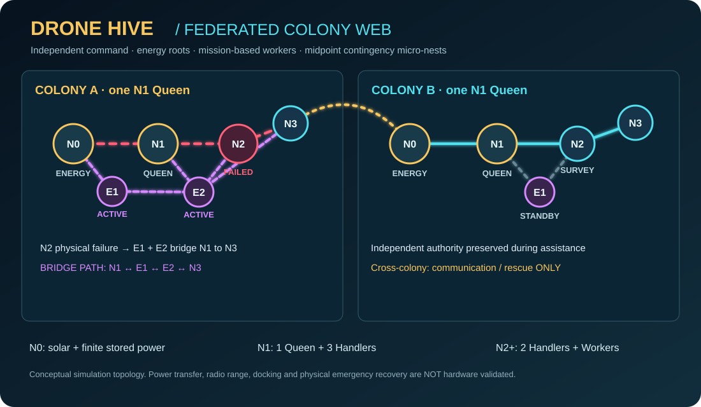

# Drone Hive — Federated Colony Exploration Simulator

**A multi-colony, bee-inspired research simulator for non-invasive reconnaissance of hazardous or inaccessible terrain.** Drone Hive models recursively deployed nests, mission-specialized reconnaissance drones, energy constraints, inter-colony assistance, and midpoint emergency micro-nests. Its archaeological demonstration environment is **inspired by Göbekli Tepe**, not a survey of the actual World Heritage site.



> **Research status:** The newer `ColonyWeb` is a deterministic, dimensionless software **prototype**. Its simulated radio, charging, movements, environmental hazards, and repair operations are not measurements of physical hardware and do not establish field safety or achievable wireless power transfer. Earlier Stage One results remain frozen and distinct.

## New: Interactive 3D Colony Operations Console (React + Three.js)

The new **[3D frontend](frontend/)** complements the Python research simulator with a cinematic procedural archaeological landscape, visible bee-inspired drones, energy roots, Queen hives, relay/retriever staffing, glowing multi-colony webs and standby midpoint micro-nests. Click nodes and eggs to inspect assignments, orbit the camera, and use built-in failure controls to demonstrate the **N1 ↔ E1 ↔ E2 ↔ N3** emergency bridge.

```bash
cd frontend
npm install
npm run dev
```

Open the local URL shown by Vite. A production bundle is created using `npm run build`.

**Current integration status:** The visual frontend uses its own **scripted TypeScript demonstration state**, matching the architectural rules but **not yet connected live to the Python `ColonyWeb` engine**. Simulated terrain, drone movement, battery state, telemetry and failures are illustrative; they are **not field measurements or a physics-calibrated robotic system**. The existing Python experimental data and models remain independently reproducible.

The visual application is in active development. Its build and static distribution artifact are verified through the [Frontend 3D Console workflow](.github/workflows/frontend.yml).

## Explore the interactive multi-colony simulator

```bash
python -m venv .venv
source .venv/bin/activate        # Windows: .venv\Scripts\activate
pip install -e ".[dev]"
python -m drone_hive.colony_web_ui
```

The new graphical console uses the **actual network simulation state** to draw nests, worker bees, inter-node links, bridging eggs, failures and colony-specific telemetry. Click a node on the map or choose it in the inspector, then:

1. **Start exploration:** mission-dependent Worker drones collect simulated reconnaissance data.
2. **Inject failure:** enter a single node (`A:N2`) or a comma-separated set (`A:N2,A:N3`). Choose communications, energy, hardware, destroyed, or blocked. Multiple nodes can fail together.
3. **Inspect bridge activation:** a physical fault automatically wakes neighboring midpoint contingency eggs for limited protective communications/refuge. Where geometry allows, the graph reroutes via the eggs.
4. **Diagnose a communications-only fault:** investigate before broad recall; a timeout initiates conservative colony-local safety retreat.
5. **Authorize repair:** selected Retriever Handlers simulate bounded maintenance; restoring a node returns eligible eggs to standby.
6. **Recall colony:** Workers and Handlers route toward a viable operational nest/egg with sufficient energy or enter shelter state.

The window's **Demo: N2 Bridge** and **Comms Failure** buttons reproduce the most important scenarios without additional setup. This UI is a working 2-D tactical visualizer with abstract terrain artwork, **not yet a photorealistic 3-D game engine**.

## Command hierarchy and recursive web

Each independent **Node 0-rooted colony has exactly one Queen at its Node 1**. Multiple colonies can establish communication and rescue assistance routes without transferring leadership authority. Node numbering denotes depth; a branch identifier is needed when a colony has multiple nodes at the same depth.

| Infrastructure | Staffing / purpose | Physical intent |
|---|---|---|
| **Node 0** | No Queen; solar generation, main battery, backup supply | Provides a rooted energy resource with finite production and storage |
| **Node 1** | **Exactly 1 Queen + 3 Handlers + mission-dependent Workers** | Primary command; Handler succession, initial Node 2 assembly, reconnaissance and logistics |
| **Nodes 2–N** | **Exactly 1 Relay Handler + 1 Retriever Handler + mission-dependent Workers** | Local communications, emergency retrieval, sensor operations, deploy next nest |
| **Eggs at inter-node midpoints** | Limited temporary **micro-nests**, not Queens | Emergency data relay, limited docking/charging/storage and temporary bypass |
| **Cross-colony assistance** | Communication and rescue support only | Never permits one colony's Queen to issue another colony's mission commands |

### Three topologies, not one magic network

- **Construction parentage:** the nest that carried and assembled a child.
- **Communication mesh:** radio links calculated separately using current geometry, link state and available egg bridges.
- **Energy accounting:** stored energy and tentative parent-to-child transfer, with explicit losses. No unbounded power creation or automatic electrical support from mere radio connectivity.

The physical long-term design uses a **foldable nest chassis plus replaceable battery, communications, contingency, docking, data-storage and local-control modules**. A parent node's Retriever or construction Handler must deliver and commission these components. Expansion requires site suitability, hardware inventory, available return energy, communication and human approval.

## Bee functions

| Bee | Assignment | Proposed sensors / payloads |
|---|---|---|
| **Queen** | Only N1, mission command, authorization, coordination, escalation | Local compute, radio, diagnostics, video/telemetry |
| **N1 Handlers (3)** | Acting Queen succession, initial construction, retrieval/recovery | Diagnostics, communication, cameras, payload/servicing |
| **Relay Handler** | Mandatory N2+; maintains upstream/downstream communication; may serve docked | Radio, positioning, signal diagnostics, telemetry |
| **Retriever Handler** | Mandatory N2+; egg placement, nest transport, retrieval, modular repairs | Gripper/cargo interface (proposed), camera, depth, battery reserve |
| **Scout Worker** | Mission-dependent; survey route, hazards, candidate nest positions | Video, depth, navigation telemetry |
| **Mapping Worker** | Mission-dependent; reconstruct terrain and geometry | Depth/LiDAR, odometry, mapping records |
| **Structure-imaging Worker** | Mission-dependent; non-contact archaeological documentation | Calibrated imaging, photogrammetry, timestamps |
| **Environmental Worker** | Mission-dependent; observe mission conditions | Thermal and environmental sensor records |

A configurable Worker may be fitted with multiple payloads only when realistic mass and energy limits permit. The prototype produces *simulated* recording counters; it does **not** currently capture camera footage, actual LiDAR, or thermal sensor data.

## Midpoint eggs: a redundant temporary infrastructure bridge

Normal corridor: `N1 — E1 — N2 — E2 — N3`

When **N2 fails physically**, E1 and E2 can wake as temporary micro-nests. If both retain capacity and radio range permits their direct link, they form the bypass:

**`N1 ↔ E1 ↔ E2 ↔ N3`**

This retains a reduced-capacity communications corridor while authorized Retrievers restore N2. Eggs are staged at adjacent-node midpoints for shorter intervention distances, rather than traveling from distant root depots. Bridging **may fail** if range, energy, docking, physical access or multiple-node damage overwhelms available reserves. Egg charging capacity is finite; a communications connection never implies electric power transfer.

### Fault response protocol

- **Energy, partial hardware damage, destruction or physical blockage:** suspend unsafe exploration; recall affected colony drones to the nearest viable powered nest or activated egg; preserve recordings; await authorized recovery.
- **Communication-only anomaly:** investigate the link and alternate mesh, maintain only pre-authorized safe activity, and recall on timeout or unsafe uncertainty.
- **Single and simultaneous multi-node outages:** activate eligible midpoint micro-nests and calculate topology; do not fabricate a path if no connected sequence exists.
- **Different-colony assistance:** neighboring colonies may help communicate or rescue but cannot take command.
- **Node restoration:** commission the repaired nest and return eligible emergency eggs to standby.

## Research lineage and scientific boundary

**Frozen Stage One** remains exactly as collected on **September 15, 2026**: compare carrier-only, fixed-relay and adaptive-frontier infrastructure policies in a dimensionless 2-D simulator. The five-seed results exposed brittle connectivity after a first-relay failure, which motivates this expanded architecture. These historic results are **not evidence that the new eggs, Queens, Handlers, or the full federated web are effective**.

Run the historic, reproducible experiment:

```bash
python -m drone_hive.cli
python -m drone_hive.dashboard
```

Original run: [2026-09-15 relay-policy baseline](data/stage_one_baseline/runs/2026-09-15_relay-policy-v1/). New numerical studies must use a separate `data/colony_recovery/runs/` protocol, randomized failures, held-out seeds, independent controls and explicit confidence intervals.

## Visual walkthrough / demo generation

```bash
python -m drone_hive.web_demo
```

Generates a **real simulator-driven** animated GIF in `demos/colony-web-operational.gif`, showing the multi-colony network, an N2 physical failure, midpoint egg bridging, response and restoration. In CI this is uploaded as a downloadable build artifact until reviewed and committed. The GIF is a 2-D graphical replay, not a screen recording of the tkinter window or a physical drone test.

## Documents

[Full physical architecture](docs/ARCHITECTURE.md) · [Colony mission and design boundaries](docs/COLONY_VISION.md) · [Failure & recovery protocol](docs/FAILURE_RECOVERY.md) · [Legacy methodology](docs/METHODS.md) · [Evidence](docs/EVIDENCE.md) · [Safety](docs/SAFETY.md) · [Roadmap](docs/ROADMAP.md) · [Evidence catalog](data/README.md)

## Verification

```bash
ruff check .
pytest -q
python -m drone_hive.cli --quick
```

The new colony web and its tests do not mutate the frozen Stage One dataset. This prototype is a research-and-design demonstration, not a field-operable autonomous drone system. Physical trials would require calibrated power/propagation models, trained operators, qualified hardware and permissions for any protected archaeological site.

## License

MIT. See [LICENSE](LICENSE) and [CITATION.cff](CITATION.cff).
