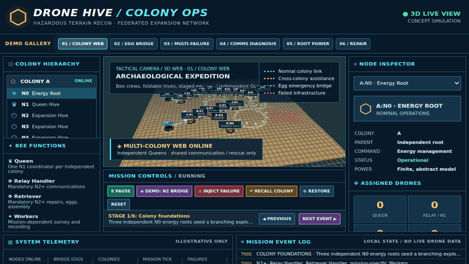
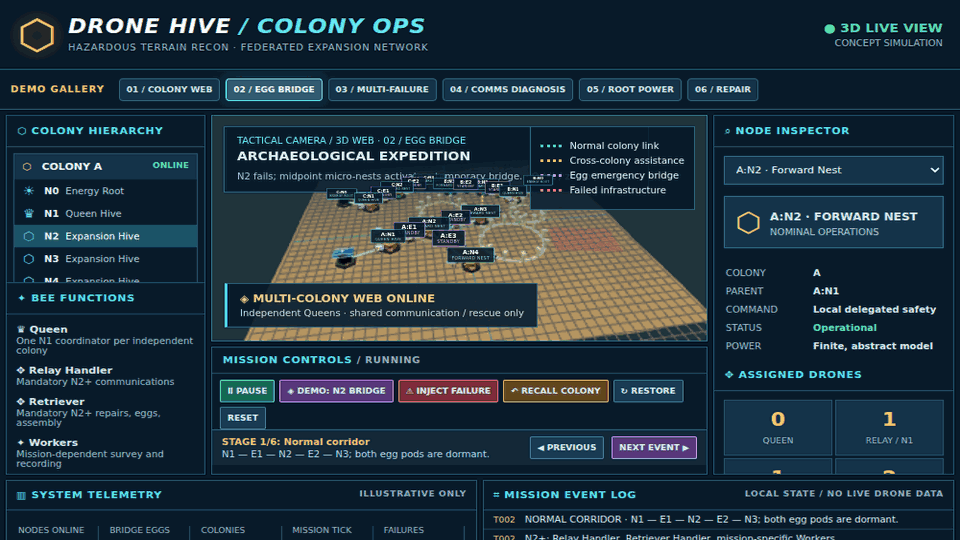
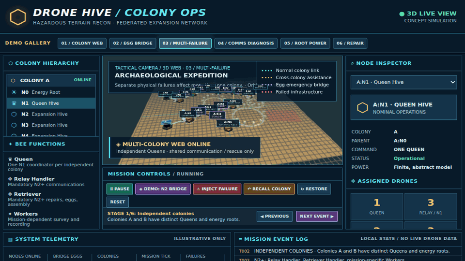
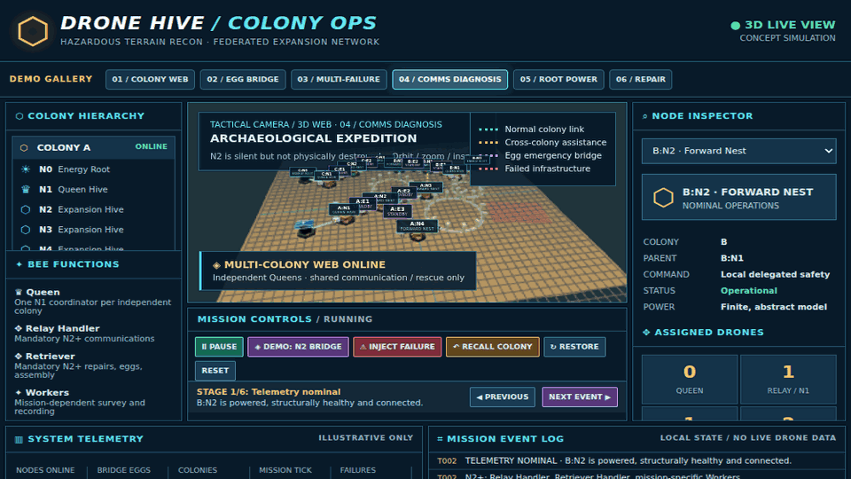
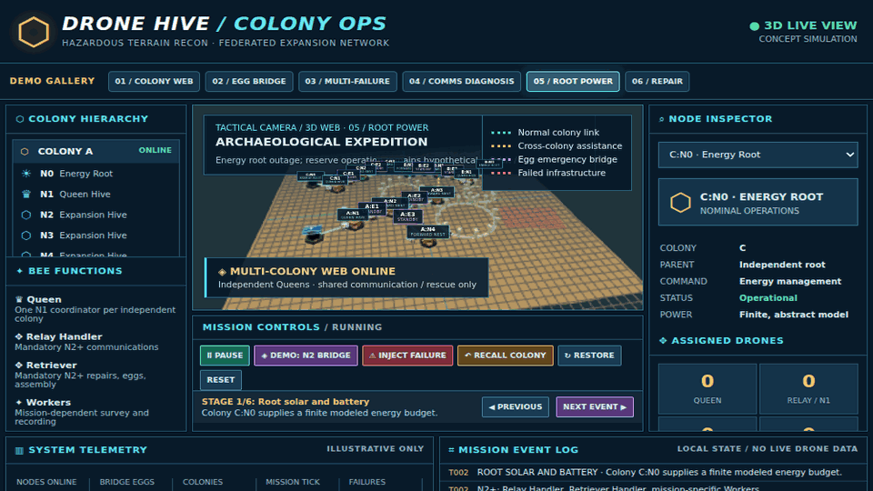
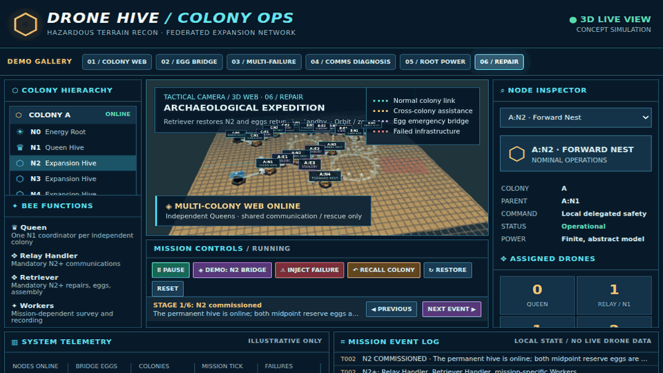

# Drone Hive — Visual Demonstrations

[Project home](../README.md) · [Documentation](INDEX.md) · [Real experiment data](../data/README.md)

The six 3D demonstrations below were recorded by rendering **three distinct scripted visual keyframes** per scenario. Within the React app, each scenario offers **six interactive stages**. These animations illustrate a concept; **they are not Python telemetry, measured radio links, hardware recordings or validated survival outcomes**.

## 3D Colony Ops — six scenarios

### 1. Colony web and bee roles


### 2. N2 failure and egg-bypass demonstration


### 3. Concurrent failures in separate colonies


### 4. Communications-only diagnosis


### 5. Root energy failure


### 6. Retriever recovery and return to standby


Start the 3D app and use the **Demo Gallery / Next Event / Previous** controls:

```bash
cd frontend
npm install
npm run dev
```

URL modes: `/?demo=overview`, `/?demo=bridge`, `/?demo=multi`, `/?demo=comms`, `/?demo=energy`, `/?demo=recovery`.

## Actual Python-driven visual evidence

The Python model has a separate 2D UI and generated demonstration; unlike the Three.js scenarios, the model-driven animation follows Python state. The video is **still a software simulation**, not a real drone field demonstration:

```bash
python -m drone_hive.colony_web_ui
python -m drone_hive.web_demo
```

The [earlier Stage One simulation recording](../demos/drone-hive-stage-one.gif) concerns infrastructure policy comparisons only. Stage Two experiment outputs are governed by the [data catalog](../data/README.md).

## Future visualization requirement

For credible scientific visualization, export a versioned, timestamped state stream from Python (nodes, drones, energy, relay mesh, failsafe, diagnostics, source seed) and replay **that stream** in Three.js. Clearly mark the switch between concept demo and experiment replay.
