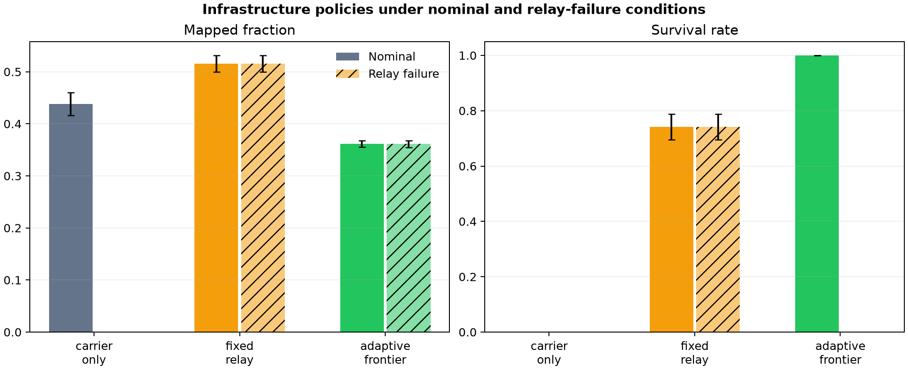
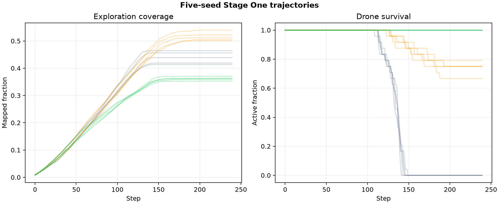

# Figures, Plots, and Their Evidence Boundaries

[README](../README.md) · [Stage One dataset](../data/stage_one_baseline/runs/2026-09-15_relay-policy-v1/) · [Stage Two test protocol](STAGE_TWO_EXPERIMENT_PROTOCOL.md)

## Stage One — historical, measured *inside the abstract simulator*

**Policy comparison.** Five seeds per tested condition, 24 drones, 240 steps. There is no carrier-only relay-failure condition.

**Time-series trajectories.** Same archived reproducibility bundle.

Raw records: [run summary](../data/stage_one_baseline/runs/2026-09-15_relay-policy-v1/run_summary.csv) · [step metrics](../data/stage_one_baseline/runs/2026-09-15_relay-policy-v1/step_metrics.csv) · [aggregate summary](../data/stage_one_baseline/runs/2026-09-15_relay-policy-v1/aggregate_summary.csv) · [manifest](../data/stage_one_baseline/runs/2026-09-15_relay-policy-v1/manifest.json)

**Readout:** Fixed relay maintained 74.17% mean simulated drone survival both nominally and under the selected first-relay failure. Adaptive frontier gave 100% nominal but 0% under that failure. Neither implies actual flight or tests the later egg network.

## Stage Two — diagnostic plots still needed

Current validated checks: software energy accounting, docking reservation invariants, simplified radio line-of-sight geometry, and seven C0–C6 configurations. **No resource-matched treatment effect is established.** Exported Stage Two ablation rows should not be presented as a ranking of policies.

Next *scientifically useful* plots after matched arms and held-out seeds:

1. **Paired safe-refuge rate by arm and fault**, with sample distribution and 95% intervals.
2. **Connectivity/recovery vs time** after N2 outages, communication uncertainty, low battery, and obstruction.
3. **Energy sources and irreversible losses** using explicit battery and charging budgets.
4. **Coverage verified against a synthetic ground-truth map**, rather than bytes recorded.
5. **Cost/resilience Pareto frontier** normalized for nests, eggs, payloads and charging equipment.

Figures derived from scripted WebGL scenes belong in the [demo gallery](DEMOS.md), not numerical research results.
